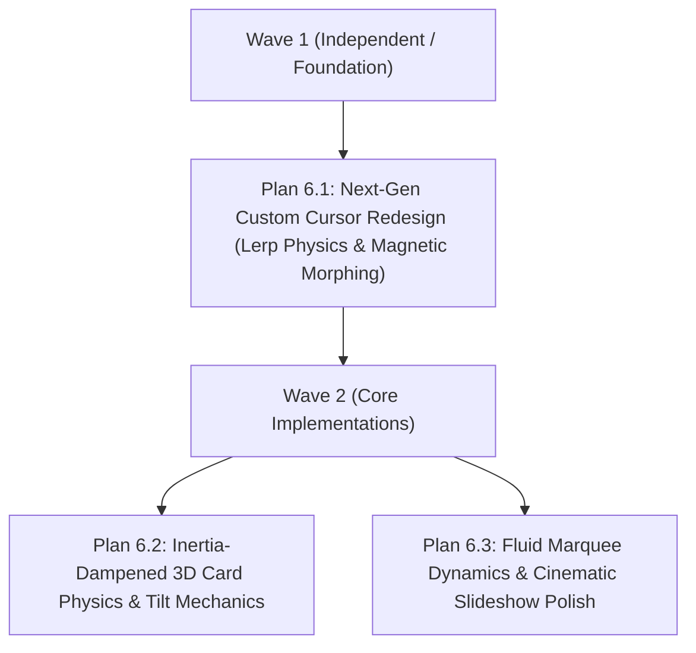

# Phase 6: Ultra-Smooth Motion System & Next-Gen Custom Cursor Redesign

## Objective
Deliver award-winning, fluid motion mechanics, inertia-dampened 3D card physics, and a redesigned high-precision adaptive custom cursor with organic magnetic snapping and context-aware states across CineSphere.

---

## Execution Wave Structure

---

## Plans Overview

### Wave 1:
- **Plan 6.1 (`.gsd/phases/6/1-PLAN.md`)**:
  - **Task 1**: Redesign `CustomCursor.tsx` with physics-based lerp trailing (`lerp(current, target, factor)`) & velocity-based squash/stretch.
  - **Task 2**: Implement magnetic attraction snapping & context-aware morphing states (`DEFAULT`, `MAGNETIC_BUTTON`, `CARD_HOVER`, `TEXT_INPUT`).

### Wave 2:
- **Plan 6.2 (`.gsd/phases/6/2-PLAN.md`)**:
  - **Task 1**: Re-architect `ThreeCard3D.tsx` tilt engine with continuous RAF lerp loop & spring return physics.
  - **Task 2**: Implement holographic specular light sheen & card hover semantic integration (`data-card="true"`).
- **Plan 6.3 (`.gsd/phases/6/3-PLAN.md`)**:
  - **Task 1**: Optimize background marquee dynamics with graceful hover deceleration & reduced-motion support.
  - **Task 2**: Polish hero spotlight slideshow with cinematic crossfades & animated timer progress bar.

---

## Verification Criteria
- [ ] Custom cursor tracks with fluid, spring-damped lerp physics at 60–120 FPS.
- [ ] Cursor organically morphs into magnetic button snap, card preview aura, or native text caret.
- [ ] 3D card tilt moves with realistic inertia dampening and returns gently to 0 on mouse leave.
- [ ] Marquee rows drift at 60+ FPS and decelerate gracefully on hover.
- [ ] Hero slideshow crossfades cleanly with an active 5.5s progress timer bar.
- [ ] `prefers-reduced-motion` cleanly disables tilt, marquee scroll, and auto-slideshow.
- [ ] Next.js production build (`npm run build`) passes cleanly with 0 type errors.
