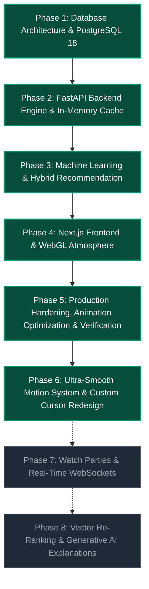

# CineSphere: Full-Stack Engineering Roadmap

**Architecture:** Next.js 15 (React 19, App Router) + FastAPI + PostgreSQL 18 with `pgvector` + WebGL/ThreeUI + GSAP  
**Execution Paradigm:** Host-Native Windows (PowerShell, Native Python 3.12, Node.js v22). **No Docker, No Redis.**

---

## 1. Roadmap Overview & Timeline

---

## 2. Core Phases Completed

### Phase 1: Database Architecture & PostgreSQL 18
**Status:** ✅ Complete  
**Deliverables:**
- 14 production tables designed with foreign keys and CASCADE integrity.
- `pgvector` extension enabled for 384-dimensional cosine similarity indexing.
- Seeded movie catalog and admin/guest authentication profiles.

### Phase 2: FastAPI Backend Engine & In-Memory Cache
**Status:** ✅ Complete  
**Deliverables:**
- Native FastAPI REST endpoints for Auth, Movies, Ratings, Watchlists, and Admin.
- Thread-safe in-memory LRU/TTL cache mechanism with zero Redis requirement.
- Pytest integration suite verifying API response codes and token security.

### Phase 3: Machine Learning & Hybrid Recommendation
**Status:** ✅ Complete  
**Deliverables:**
- Custom Factorized SGD and ALS collaborative filtering models.
- Hybrid blender weighting collaborative predictions with pgvector semantic similarity.
- Offline metrics evaluation pipeline (RMSE, Precision@K, Recall@K, MAP, NDCG).

### Phase 4: Next.js Frontend & WebGL Atmosphere
**Status:** ✅ Complete  
**Deliverables:**
- Next.js 15 App Router client with React 19 server/client boundaries.
- Interactive ThreeUI shader atmosphere (`FluidFieldBackground`, `NebulaBackground`, `WarpFieldBackground`).
- GSAP-powered custom cursor, 3D card perspective tilt, and animated context menus.

### Phase 5: Production Hardening, Animation Optimization & Verification
**Status:** ✅ Complete  
**Deliverables:**
- Fixed runtime ReferenceErrors in 3D card leave events and GSAP stagger recursion.
- Replaced 120-layer backdrop blur in marquee carousel with GPU-friendly translucent styling.
- Verified 16/16 backend pytest unit tests passing.
- Verified 13/13 Next.js routes compiling with zero type or build errors.

---

## 3. Future Phases & Next Horizon

### Phase 6: Ultra-Smooth Motion System & Next-Gen Custom Cursor Redesign
**Status:** ✅ Complete  
**Objective:** Deliver award-winning, fluid motion mechanics, inertia-dampened 3D card physics, and a redesigned high-precision adaptive custom cursor with organic magnetic snapping and context-aware states.  
**Key Deliverables:**
- [x] Redesigned dual-tier magnetic cursor with organic trailing physics, velocity scaling, and sleek minimal aesthetics.
- [x] Context-aware cursor morphing states (hover pill over cards, magnetic snap on buttons, text caret, drag indicator).
- [x] Smooth 3D card tilt with lerped inertia dampening (`lerp(current, target, 0.1)`) and buttery spring recovery.
- [x] Fluid marquee acceleration/deceleration on hover and optimized 60–120 FPS continuous drifting.
- [x] Seamless hero spotlight crossfading with animated progress bars and slide transitions.

**Plans:**
- [x] Plan 6.1: Next-Gen Custom Cursor Redesign (Adaptive Morphing & Magnetic Snapping)
- [x] Plan 6.2: Inertia-Dampened 3D Card Physics & Smooth Tilt Mechanics
- [x] Plan 6.3: Fluid Marquee Dynamics & Cinematic Slideshow Polish

### Phase 7: Watch Parties & Real-Time WebSockets
**Status:** ⬜ Planned  
**Objective:** Introduce synchronized real-time social movie watching rooms and live community feeds.  
**Key Deliverables:**
- [ ] FastAPI WebSocket gateway (`/ws/rooms/{room_id}`) for synchronized playback state and room chat.
- [ ] Next.js Watch Party client interface with floating participant video avatars.
- [ ] Real-time activity ticker displaying community ratings and watchlist additions live.

### Phase 8: Vector Re-Ranking & Generative AI Explanations
**Status:** ⬜ Planned  
**Objective:** Enhance recommendation explainability using natural language models and multi-modal embeddings.  
**Key Deliverables:**
- [ ] Integrate Gemini API for personalized 2-sentence conversational "Why You'll Love This" movie pitches.
- [ ] Semantic natural language search bar ("Show me cerebral 90s sci-fi movies with rainy cyberpunk aesthetics").
- [ ] Automated TMDB weekly catalog delta sync worker script.

---

## 4. Progress Summary Matrix

| Phase | Description | Status | Deliverables | Verification |
|---|---|---|---|---|
| **Phase 1** | PostgreSQL 18 & pgvector Schema | ✅ Complete | 14 Tables + DDL + Seeds | SQL queries & DB inspection |
| **Phase 2** | FastAPI REST API & In-Memory Cache | ✅ Complete | Auth, Movies, Ratings, Watchlists | Live HTTP lifecycle tests |
| **Phase 3** | Custom ML Recommender & Evaluator | ✅ Complete | Factorized SGD, ALS, RecSys Metrics | `test_rec_math.py` passed |
| **Phase 4** | WebGL Shaders & GSAP Animations | ✅ Complete | ThreeUI, Cursor, 3D Cards, Radial Wheel | 60–120 FPS trace |
| **Phase 5** | Hardening, Bug Fixes & Verification | ✅ Complete | Dead code removed, 16/16 tests pass | Pytest & next build |
| **Phase 6** | Smooth Motion & Cursor Redesign | ✅ Complete | Adaptive cursor, lerped tilt, marquee | 120 FPS trace & build |
| **Phase 7** | Watch Parties & WebSockets | ⬜ Planned | Live rooms & real-time chat | Planned |
| **Phase 8** | LLM Explanations & Natural Search | ⬜ Planned | Generative recs & semantic search | Planned |

---

*Last updated: November 2026*
